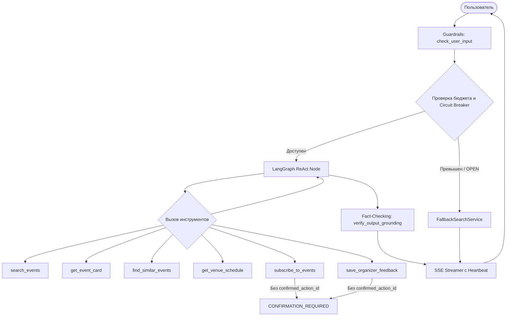

# Документация бэкенда «Афиша культуры Башкортостана»

Данный документ содержит детальное описание архитектуры, компонентов и руководств по разработке сервиса бэкенда.

---

## 1. Архитектурная структура модулей (`app/`)

Бэкенд спроектирован по принципам Clean Architecture и разделен на изолированные слои:

```
backend/app/
├── core/                       # Системное ядро и инфраструктурные компоненты
├── models/                     # Декларативные модели данных SQLAlchemy 2.0
├── schemas/                    # Pydantic v2 DTO и контракты взаимодействия
├── repositories/               # Асинхронный слой доступа к данным (DAL)
├── services/                   # Бизнес-логика, нормализация, дедупликация и поиск
├── agent/                      # Диалоговый AI-агент Level 3 на LangGraph
└── api/                        # Контроллеры FastAPI и зависимости внедрения (DI)
```

---

## 2. Системное ядро (`app/core/`)

- [`config.py`](file:///home/scoof/Downloads/afisha/backend/app/core/config.py):
  Класс `Settings` на базе `pydantic-settings`. Считывает переменные окружения: параметры подключения к PostgreSQL (`DATABASE_URL`, `CHECKPOINT_DB_URI`), параметры LLM (`LLM_BASE_URL`, `LLM_API_KEY`, `LLM_MODEL_NAME`), а также жесткие ограничения бюджета и таймингов:
  - `LLM_TIMEOUT_SEC = 6.0`
  - `MAX_AGENT_STEPS = 5`
  - `MAX_DIALOG_COST_RUB = 5.0`
  - `MAX_DAILY_USER_BUDGET_RUB = 25.0`
  - `ADMIN_API_TOKEN` — токен для защищенных административных эндпоинтов.

- [`database.py`](file:///home/scoof/Downloads/afisha/backend/app/core/database.py):
  Класс `DatabaseManager`. Управляет двумя пулами соединений:
  1. `AsyncEngine` (SQLAlchemy 2.0 / `asyncpg`) с настройкой `expire_on_commit=False` во избежание `DetachedInstanceError`.
  2. `psycopg_pool.AsyncConnectionPool` специально для LangGraph `AsyncPostgresSaver`. Обязательные параметры пула: `autocommit=True` и `row_factory=dict_row` для корректной работы сериализации чекпоинтов.

- [`logging.py`](file:///home/scoof/Downloads/afisha/backend/app/core/logging.py):
  Конфигурация `structlog` в формате JSON. Реализован процессор `PIIScrubberProcessor`, соответствующий требованиям 152-ФЗ. Он автоматически находит и заменяет на `[SCRUBBED]`:
  - Российские телефонные номера (`+7...`, `89...`, `8...`)
  - Адреса электронной почты
  - IPv4 и IPv6 адреса
  - Токены Bearer и API ключи
  Также внедрен контекстный логгер со сквозным `request_id`.

- [`exceptions.py`](file:///home/scoof/Downloads/afisha/backend/app/core/exceptions.py):
  Иерархия исключений приложения с базовым классом `AppError` и единый обработчик `rfc7807_exception_handler`. Любая ошибка отдает ответ `application/problem+json` со структурой `ProblemDetails`:
  - `EventNotFoundError` (HTTP 404)
  - `ValidationFailedError` (HTTP 422)
  - `RateLimitExceededError` (HTTP 429)
  - `AgentBudgetExceededError` (HTTP 503)
  - `UnauthorizedAdminError` (HTTP 401)

- [`security.py`](file:///home/scoof/Downloads/afisha/backend/app/core/security.py):
  Криптографические и защитные механизмы:
  - `generate_source_hash(source_url, title, date_start)` — SHA-256 хеш для 100% идемпотентности повторного импорта.
  - `generate_dedup_key(city, venue, date_start, normalized_title)` — ключ дедупликации мероприятий.
  - `SlidingWindowRateLimiter` — скользящее окно запросов по IP/ChatID.
  - `verify_admin_token` — безопасное сравнение токенов администратора (`secrets.compare_digest`).

- [`circuit_breaker.py`](file:///home/scoof/Downloads/afisha/backend/app/core/circuit_breaker.py):
  `LLMCircuitBreaker` для защиты от сбоев внешних AI-провайдеров. Состояния:
  - `CLOSED` — нормальная работа.
  - `OPEN` — при 3 последовательных сбоях или превышении лимита времени (6 сек). Все вызовы сразу направляются в резервный сервис без обращения к сети.
  - `HALF_OPEN` — тестовый запрос после периода охлаждения (30 сек) для восстановления нормальной работы.

---

## 3. Модели данных и миграции (`app/models/`, `migrations/`)

База данных работает на **PostgreSQL 16** со следующими расширениями:
- `vector` (pgvector): векторные эмбеддинги 1536 измерений и индекс HNSW.
- `pg_trgm`: триграммный поиск и расчет схожести названий/городов.
- `btree_gist`: составные GiST-индексы.

### Таблицы:
1. `cities` — Справочник городов Башкортостана (`id`, `name`, `normalized_name`, триграммный индекс).
2. `venues` — Справочник культурных площадок (`id`, `city_id`, `name`, `normalized_name`, `address`, `coordinates`).
3. `raw_event_records` — Сырые данные импорта (`id`, `source_type`, `source_hash`, `raw_payload`, `status`). Гарантирует изоляцию исходных данных и возможность повторного пересчета.
4. `events` — Основная таблица опубликованных и модерируемых мероприятий:
   - `tsv` (TSVECTOR) — автогенерируемый вектор полнотекстового поиска с весами `A` (название, площадка) и `B` (описание).
   - `embedding` (Vector(1536)) — векторное представление для семантического поиска с HNSW-индексом (`m=16`, `ef_construction=64`, `vector_cosine_ops`).
   - `dedup_key` — уникальный SHA-256 ключ дедупликации.
   - `is_cancelled` — флаг отмены мероприятия (отмененные события остаются доступны по прямым ссылкам с бейджем отмены).
5. `event_sources` — Ссылки на внешние первоисточники сбора данных.
6. `subscriptions` — Подписки пользователей на уведомления (`telegram_chat_id` типа `BIGINT` для поддержки 64-битных Telegram ID).
7. `feedback_requests` — Запросы обратной связи от организаторов культурных мероприятий.
8. `audit_logs` — Логи действий администраторов и модераторов.
9. `agent_traces` — Трассировка вызовов агента LangGraph (токены, стоимость в рублях, использованные инструменты).

---

## 4. Слой доступа к данным (`app/repositories/`)

Все методы репозиториев строго асинхронны и используют `AsyncSession`.

- [`event_repo.py`](file:///home/scoof/Downloads/afisha/backend/app/repositories/event_repo.py):
  - `hybrid_search`: объединяет полнотекстовый поиск (`ts_rank` со словарем `'russian'`) и векторный поиск (`embedding <=> :vector`) по формуле **Reciprocal Rank Fusion**:
    $$RRF = \frac{0.4}{60 + \text{rank}_{text}} + \frac{0.6}{60 + \text{rank}_{vec}}$$
  - **Автоматическая деградация:** если `query_embedding is None`, поиск переключается на комбинацию FTS и триграммного поиска (`similarity(normalized_title, :q)` $\ge 0.15$).
  - `diagnose_blocking_constraints`: диагностика пустой выдачи. Выполняет условные агрегаты `COUNT(*) FILTER (...)`, поочередно исключая ограничения (цена, дата, категория, возраст), и сообщает, какое условие заблокировало выдачу.
  - `get_by_id`: извлечение мероприятия (включая отмененные) с жадной подгрузкой источников (`selectinload(Event.sources)`).
  - `find_similar_events`, `get_venue_schedule`, `create_or_update_event`, `list_moderation_queue`.

- [`dictionary_repo.py`](file:///home/scoof/Downloads/afisha/backend/app/repositories/dictionary_repo.py):
  - `resolve_city_name`: нечеткий поиск города по триграммам `pg_trgm` с порогом схожести $\ge 0.45$. Например, запрос «Стерлитомак» корректно резолвится в «Стерлитамак».

- [`audit_trace_repo.py`](file:///home/scoof/Downloads/afisha/backend/app/repositories/audit_trace_repo.py):
  - `get_user_daily_spend_rub`: агрегирует сумму расходов конкретного пользователя за текущие календарные сутки.

---

## 5. Сервисный слой (`app/services/`)

- [`normalization_service.py`](file:///home/scoof/Downloads/afisha/backend/app/services/normalization_service.py):
  - Нормализация заголовков (удаление мусора, лишних пробелов, HTML-тегов).
  - Парсинг цен: извлекает `(price_min, price_max, is_free)` из строк вида «от 300 до 1500 руб», «вход свободный», «бесплатно».
  - Приведение временных меток к часовому поясу Башкортостана (`Asia/Yekaterinburg`, UTC+5).
  - Приведение возрастных цензов к дискретной шкале: `0`, `6`, `12`, `16`, `18`.

- [`deduplication_service.py`](file:///home/scoof/Downloads/afisha/backend/app/services/deduplication_service.py):
  - Метод `merge_event_fields`: слияние карточек из нескольких источников с учетом авторитетности первоисточника.
  - Оценка уровня доверия (`confidence_score`) и выставление флага диспута (`is_disputed`) при расхождении критических параметров (цена, время начала).

- [`import_service.py`](file:///home/scoof/Downloads/afisha/backend/app/services/import_service.py):
  - Идемпотентный импорт из CSV и JSON.
  - Метод `replay_all_normalizations`: перепрогон правил нормализации по всем сохраненным записям `raw_event_records`.

- [`fallback_search_service.py`](file:///home/scoof/Downloads/afisha/backend/app/services/fallback_search_service.py):
  - Детерминированный парсер запросов на базе регулярных выражений и словарей без обращения к LLM. Извлекает категории («концерт», «театр», «выставка»), даты («сегодня», «завтра», «на выходных») и ценовые ограничения («бесплатно», «до 1000 руб»).

---

## 6. ИИ-агент на LangGraph (`app/agent/`)

Архитектура агента реализует **3-й уровень автономности**:



- **Guardrails:**
  - `check_user_input`: блокировка prompt injection попыток.
  - Спотлайтинг: внешние тексты описаний из БД оборачиваются в `<untrusted_event_description>`, предотвращая атаки непрямого внедрения промптов.
  - `verify_output_grounding`: верификация 100% привязки фактов ответа к данным, возвращенным инструментами (Zero Hallucination).
- **Инструменты (Tools):**
  6 строго типизированных функций Pydantic/LangChain. Все мутирующие операции требуют двухфазного подтверждения.
- **Память (Checkpointer):**
  `AsyncPostgresSaver` с обрезкой контекста (`trim_conversation_history`), гарантирующей сохранение последних 5 диалоговых реплик.

---

## 7. Контроллеры API (`app/api/`)

- `GET /api/v1/events/`: публичный каталог с фильтрацией, сортировкой, пагинацией и диагностикой пустой выдачи.
- `GET /api/v1/events/{event_id}`: карточка мероприятия с поддержкой HTTP заголовков `Cache-Control`, `ETag` и `304 Not Modified`. Отмененные события возвращают `cancelled_badge`.
- `POST /api/v1/chat/message`: синхронный эндпоинт отправки сообщения агенту.
- `GET /api/v1/chat/stream`: Server-Sent Events (SSE) потоковый стриминг с генерацией событий `token`, `recommendations`, `action_required` и `heartbeat` (раз в 10 секунд).
- `POST /api/v1/subscriptions/`: оформление подписки на уведомления.
- `POST /api/v1/feedback/`: отправка обращения организатора.
- `POST /api/v1/admin/import/csv`: пакетный импорт CSV с подсчетом добавленных, сведенных и отклоненных строк.
- `POST /api/v1/admin/events/{event_id}/status`: модерация и изменение статуса мероприятия.
- `GET /health`: проверка готовности сервиса и пула соединений с БД.
